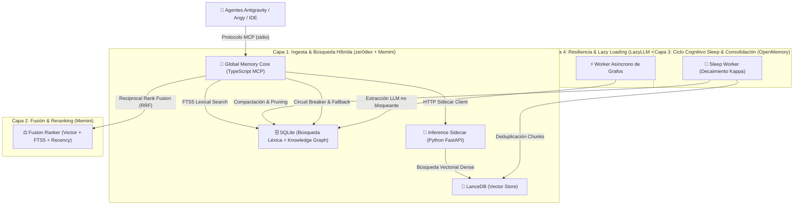

# 🛡️ VANGUARD IDE v5.0: Arquitectura de Memoria Híbrida & Orquestación Autónoma

> **Estado:** Especificación Maestra & Blueprint  
> **Inspiración:** LangGraph, zer0dex, Memini, OpenMemory, AgentOps, Swarms, LazyLLM & MCP Standard

---

## 🏛️ Visión General de la Arquitectura

Vanguard IDE v5.0 evoluciona el motor de contexto de los agentes hacia un **Sistema de Memoria Cognitiva Híbrida de 4 Capas**, eliminando dependencias quemadas, bloqueos sincrónicos y degradación de rendimiento.



---

## 📦 1. Los 4 Pilares Arquitectónicos

### Pillar 1: Ingesta Dual & Búsqueda Híbrida (zer0dex + Memini)
- **zer0dex Pattern:** Mantiene un índice transparente en Markdown legible por humanos acoplado con vectores de alta densidad.
- **Memini Pattern (RRF Hybrid Search):** Las consultas ejecutan en paralelo:
  1. **Búsqueda Léxica Exacta:** Vía SQLite FTS5 (símbolos de código, nombres de funciones, IDs).
  2. **Búsqueda Semántica:** Vía LanceDB (conceptos, intents y explicaciones).
  3. **Fusión:** Se combinan con **Reciprocal Rank Fusion (RRF)**:
     $$\text{Score}(d) = \sum_{m \in M} \frac{1}{k + r_m(d)}$$

### Pillar 2: Ciclos Cognitivos de Consolidación ("Sleep Mode" de OpenMemory)
- Mantenimiento asíncrono ejecutado en horarios de baja actividad o background:
  - **Decaimiento Temporal ($\gamma$):** Aplicado a los pesos del grafo Knowledge Graph según la antigüedad sin acceso.
  - **Olvido Selectivo:** Compactación de fragmentos redundantes y limpieza de nodos huérfanos.

### Pillar 3: Resiliencia & Execution Safety (LazyLLM + Circuit Breaker)
- **Extracción de Grafos Desacoplada (LazyLLM):** La generación de grafos mediante LLM (`qwen2.5:7b` / `phi3:mini`) corre en un worker asíncrono secundario. **Jamás bloquea la indexación vectorial ni la respuesta de la memoria**.
- **Circuit Breaker con Fallback:** Si el Sidecar de Python o Ollama no responden en < 500ms, el sistema conmuta automáticamente al grafo estructural SQLite.

### Pillar 4: Estado Persistente y Monitoreo (LangGraph + AgentOps)
- Registro persistente de la trayectoria de tareas en SQLite.
- Auditoría de fallas registradas mediante la herramienta `record_failure` para prevenir antipatrones repetidos.

---

## ⚙️ 2. Estructura de Configuración Unificada (`Zero Hardcode`)

### TypeScript (`src/config.ts`)
```typescript
import dotenv from 'dotenv';
import path from 'path';
import os from 'os';

dotenv.config();

export const CONFIG = {
  PORT: process.env.PORT || 8000,
  PYTHON_INFERENCE_URL: process.env.PYTHON_INFERENCE_URL || 'http://127.0.0.1:8000',
  OLLAMA_URL: process.env.OLLAMA_URL || 'http://127.0.0.1:11434',
  EMBEDDING_MODEL: process.env.EMBEDDING_MODEL || 'ollama/nomic-embed-text',
  GRAPH_MODEL: process.env.GRAPH_MODEL || 'phi3:mini',
  DB_DIR: process.env.LANCEDB_DIR || path.join(os.homedir(), '.gemini', 'antigravity', 'lancedb_store'),
  SQLITE_PATH: process.env.SQLITE_PATH || path.join(os.homedir(), '.gemini', 'antigravity', 'vanguard_graph.db')
};
```

---

## 📝 3. Hoja de Ruta de Implementación

1. ✅ **Configuración Unificada:** Eliminar todas las URLs e IPs quemadas.
2. ✅ **Búsqueda Híbrida FTS5 + LanceDB:** Implementar el índice FTS5 en SQLite y el fusionador RRF.
3. ✅ **Worker de Grafos Asíncrono:** Mover `extractEntitiesFromChunk` a una cola desacoplada.
4. ✅ **Repositorio GitHub:** Inicializar y sincronizar `00_Vanguard_IDE` en `Chexfor/00_Vanguard_IDE`.
